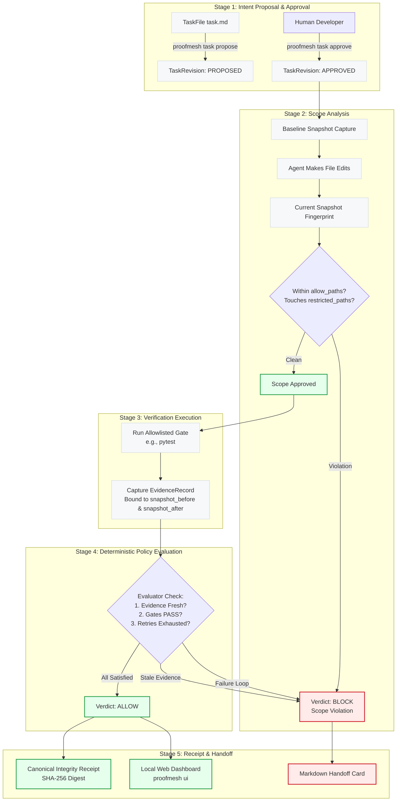

# ProofMesh

**An agent-neutral intent, intervention, and evidence control layer for AI-assisted software development.**

[](LICENSE)
[](pyproject.toml)
[](docs/testing.md)
[](docs/architecture.md)

ProofMesh enforces approved task intent, detects scope drift and repeated failure loops, and requires fresh, code-bound verification evidence before coding agents can declare work complete. It operates alongside existing developer agents via standard protocols without requiring a new agent orchestrator, custom harness, or model loop.

---

## Hackathon Track Alignment (Devin Hacks Kochi)

ProofMesh is designed for the **Devin Hacks Kochi** hackathon tracks:

| Hackathon Track | Alignment & ProofMesh Solution | Relevant Documentation |
| :--- | :--- | :--- |
| **Track 2: Make the Invisible Visible** *(Primary Track)* | Exposes invisible agent failure modes: unmonitored scope drift, unverified test claims, stale evidence, and loop failure cycles. Surfaces real-time status through structured Markdown handoff cards, machine-verifiable canonical integrity receipts, and a zero-dependency local web dashboard (`proofmesh ui`). | [Track 2 Alignment Details](docs/BUILD_TRACKS.md#track-2-make-the-invisible-visible-primary-track) |
| **Track 3: Works Anyway** | 100% local-first control loop with zero cloud, model API, or external network dependencies. Fails closed with bounded 64KB memory stream drainers, subprocess sandboxing, symlink traversal guards, and atomic SQLite persistence. Functions reliably even during cloud outages or token exhaustion. | [Track 3 Alignment Details](docs/BUILD_TRACKS.md#track-3-works-anyway) |
| **Track 1: Kill the Busywork** | Eliminates manual PR review ping-pong and repetitive verification chores by automating scope containment checks, binding test evidence to exact git snapshots, and generating self-contained audit receipts for reviewers. | [Track 1 Alignment Details](docs/BUILD_TRACKS.md#track-1-kill-the-busywork) |

See [docs/BUILD_TRACKS.md](docs/BUILD_TRACKS.md) for the complete track-by-track mapping and technical evidence.

---

## The Problem

Modern AI coding agents (such as Antigravity, Devin, Claude Code, Cursor, Codex, and OpenCode) generate diffs rapidly, but operate without structural guardrails:

1. **Silent Scope Drift:** Agents wander outside assigned tasks—modifying shared libraries, altering deployment configs, or editing infrastructure scripts without explicit permission.
2. **Compounding Unverified Assumptions:** Agents frequently proclaim *"All 15 tests pass!"* based on cached results from previous turns or unverified internal simulations. In reality, tests may be broken or unexecuted.
3. **Ignored Rules Files:** Plain text system prompts and markdown advisory rules (`AGENTS.md`, `.cursorrules`) degrade as context windows expand, leaving the agent effectively unguided during long coding sessions.
4. **Endless Failure Loops:** When tests fail, agents often repeat identical ineffective code modifications until their token budget or user patience is exhausted.

---

## The Solution

ProofMesh introduces a **lightweight, agent-neutral control layer** positioned directly between the AI agent, the developer, and the repository.

ProofMesh does not generate code, run model prompts, or replace IDEs. Instead, it enforces structural invariants:

- **Approved Task Contracts:** Agents cannot act on informal prompts. Work requires an approved `TaskFile` contract specifying allowed file paths and required verification gates.
- **Repository Snapshot Invariants:** Before and after code modifications, ProofMesh captures complete workspace snapshots. Any modification outside `allow_paths` or touching `restricted_paths` results in an immediate **BLOCK** verdict.
- **Snapshot-Bound Evidence Freshness:** Tests are executed via allowlisted subprocess gates (`pytest`, `ruff`, etc.). The resulting evidence is cryptographic hash-bound to the exact code state it checked (`snapshot_before` and `snapshot_after`). If the agent touches any file after running tests, the evidence is immediately invalidated.
- **Deterministic Intervention:** A deterministic policy evaluator returns one of three verdicts: `ALLOW`, `BLOCK`, or `REQUIRE_APPROVAL`. If repeated failure loops are detected, the loop detector exhausts the retry budget and halts the agent.
- **Canonical Integrity Receipts:** Completed work is exported as a canonical JSON integrity receipt sealed with a deterministic SHA-256 digest (`receipt_digest`), giving human reviewers verifiable proof of what was executed.

```
                      +-------------------+
                      | Human Developer / |
                      |    Code Review    |
                      +---------+---------+
                                | (Explicit Human Approval)
                                v
+-------------+        +-----------------+        +--------------------+
|  AI Coding  | <----> |    ProofMesh    | <----> | Target Repository  |
|    Agent    |  MCP/  |  Control Layer  | Subproc| (Git Workspace &   |
| (Any Host)  |  Hooks | (Policy/Store)  | Gates  |  File Snapshots)   |
+-------------+        +--------+--------+        +--------------------+
                                |
                                v
                      +-------------------+
                      | Canonical Receipt |
                      |  & Local Web UI   |
                      +-------------------+
```

---

## How It Works: The 5-Stage Control Loop



For detailed specifications, sequence flows, and database schemas, see [docs/architecture.md](docs/architecture.md).

---

## Current Implementation Status

ProofMesh is fully implemented, verified, and hardened:

- **Automated Test Suite:** **265 passed** automated tests across 24 test suites under both **CPython 3.14.9** (`.venv314`) and **Python 3.12.3** (`.venv`).
- **Zero External Dependencies:** Built with Python standard library (`sqlite3`, `http.server`, `subprocess`), `pydantic` v2, and the official `mcp` SDK. No remote servers, paid API keys, or Docker containers required.

### Capability Matrix

| Capability | Status | Implementation Evidence |
| :--- | :--- | :--- |
| **TaskFile Contract & Approval** | **Implemented & Verified** | Structured Markdown parser with TOML front matter, linear revisions (`N+1`), atomic SQLite approvals, untrusted self-approval stripping. (`src/proofmesh/core/taskfile_md.py`, `task_service.py`). |
| **Repo Snapshot & Scope Control** | **Implemented & Verified** | Deterministic SHA-256 fingerprinting, git state capture, symlink traversal protection, fail-closed path pattern evaluation. (`src/proofmesh/core/repo_snapshot.py`, `scope_analyzer.py`). |
| **Verification Gate Execution** | **Implemented & Verified** | Allowlisted subprocess gate execution (`shell=False`, argument arrays, bounded 64KB memory drainers, 2000-char summaries, execution timeouts). Snapshot hash binding (`snapshot_before`/`snapshot_after`). (`src/proofmesh/core/verification.py`, `providers/pytest_runner.py`). |
| **Policy Evaluation & Loop Detection** | **Implemented & Verified** | Deterministic evaluator (`ALLOW`, `BLOCK`, `REQUIRE_APPROVAL`), mandatory gate enforcement, persistent restart loop tracking across SQLite. (`src/proofmesh/core/evaluator.py`, `loop_detector.py`). |
| **Seeded 10-Phase Recovery Demo** | **Implemented & Verified** | Complete deterministic recovery scenario with non-destructive filesystem safety. (`src/proofmesh/demo.py`). |
| **Model Context Protocol (MCP)** | **Implemented & Verified** | Official Python MCP stdio server with tools: `proofmesh_get_contract`, `proofmesh_inspect_changes`, `proofmesh_run_gate`, `proofmesh_get_verdict`, etc. (`src/proofmesh/adapters/mcp_server.py`). |
| **Host Lifecycle Hook Adapter** | **Implemented & Verified** | Antigravity lifecycle hook adapter (`PreInvocation`, `PreToolUse`, `Stop`) with denial/continuation semantics and honest status reporting. (`src/proofmesh/adapters/antigravity.py`). |
| **Local Web Dashboard** | **Implemented & Verified** | Minimal, zero-dependency read-only web panel (`proofmesh ui`) bound to `127.0.0.1`. (`src/proofmesh/ui.py`). |
| **Unified CLI Entrypoint** | **Implemented & Verified** | Subcommands: `init`, `task propose`, `task approve`, `status`, `verify`, `evaluate`, `report`, `ui`, `mcp`, `demo`. (`src/proofmesh/cli.py`, `./proofmesh`). |
| **Canonical Integrity Receipts** | **Constrained / Honest** | Unkeyed SHA-256 digest (`receipt_digest`) over canonical JSON. Provides tamper detection, not cryptographic non-repudiation. (`src/proofmesh/report.py`). |
| **Subprocess Timeout Handling** | **Constrained / Honest** | Process cancellation calls `proc.kill()` directly on the child process; process-group killing (`os.killpg`) is not currently implemented. (`src/proofmesh/core/verification.py`). |
| **CLI Hook Subcommand** | **Planned Future Work** | Host hooks currently invoked via `python -m proofmesh.adapters.antigravity <event>`; `proofmesh hook` subcommand is planned. |

---

## Quick Start & Verification

### Prerequisites

- **Python:** Version `3.12`, `3.13`, or `3.14` (`pyproject.toml` specifies `requires-python = ">=3.12,<3.15"`).
- **Git:** Standard git client for repository snapshotting.
- **Virtual Environment Manager:** `uv` (recommended) or standard `python3 -m venv`.

### 1. Installation

```bash
# Clone the repository
git clone https://github.com/ivin-titus/ProofMesh.git
cd ProofMesh

# Option A: Using uv (fastest)
uv venv
uv pip install -e ".[dev]"

# Option B: Using standard Python venv
python3 -m venv .venv
source .venv/bin/activate
pip install -e ".[dev]"
```

> [!TIP]
> **Convenience Root Runner:** A root script `./proofmesh` is provided. It automatically detects `.venv` or `.venv314` and configures `PYTHONPATH=src`. You can run `./proofmesh <command>` directly without manual path configuration.

### 2. Run the Test Suite

```bash
# Run all 265 automated tests
pytest tests/

# Or via the convenience runner
./proofmesh --help
```

---

## Running the Deterministic Seeded Demo

ProofMesh includes a self-contained, 10-phase recovery control loop demo that executes without network or live LLM dependencies:

```bash
./proofmesh demo --dir demo_target
```

### What the Demo Proves

The demo walks step-by-step through a complete agent intervention cycle:

1. **Phase 1: Project Initialization:** Establishes isolated SQLite database outside target repository.
2. **Phase 2: Task Contract Proposal:** Proposes `TaskFile` requiring pytest gate and restricting scope to `src/math_service.py` and `tests/test_math.py`.
3. **Phase 3: Human Approval:** Explicitly approves revision 1 with audit reason.
4. **Phase 4: Baseline Snapshot:** Captures clean initial repository fingerprint.
5. **Phase 5: Clean Code Implementation:** Adds requested math functions within allowed paths.
6. **Phase 6: Verification Gate Execution:** Executes real `pytest` subprocess gate; records fresh `EvidenceRecord`.
7. **Phase 7: Pre-Violation Evaluation:** Evaluates state; returns verdict **ALLOW**.
8. **Phase 8: Scope Violation Injection:** Simulates an agent wandering outside scope by modifying restricted file `config/security.toml`.
9. **Phase 9: Intervention & Block:** Evaluator catches violation; returns verdict **BLOCK** and generates a structured handoff card.
10. **Phase 10: Clean Correction & Receipt:** Reverts violation; reruns fresh verification; evaluates to **ALLOW**; exports canonical JSON receipt and Markdown report.

**Generated Artifacts:**
- Formatted Markdown verification report: `demo_target/report.md`
- Canonical JSON integrity receipt: `demo_target/report.json`
- Blocked audit record preserved: `demo_target/report-blocked.md`

---

## ProofMesh CLI Commands

```bash
# Initialize ProofMesh for a repository workspace
./proofmesh init --path .

# Propose a TaskFile contract
./proofmesh task propose task.md

# Approve a proposed revision (explicit human sign-off)
./proofmesh task approve <task-id> 1 --by alice --reason "Approved implementation scope"

# Check active session and contract status
./proofmesh status

# Run an allowlisted verification gate (e.g., pytest)
./proofmesh verify test

# Evaluate active session against scope, evidence, and policy
./proofmesh evaluate

# Render Markdown report or export canonical JSON receipt
./proofmesh report
./proofmesh report --json

# Launch local read-only web status dashboard
./proofmesh ui --port 8765

# Start official Model Context Protocol (MCP) server over stdio
./proofmesh mcp
```

---

## Agent & Host Integrations

### Model Context Protocol (MCP)

To connect ProofMesh to any MCP-compliant coding agent (such as Claude Desktop, Cursor, or OpenCode), add the stdio server to your agent configuration:

```json
{
  "mcpServers": {
    "proofmesh": {
      "command": "/path/to/ProofMesh/proofmesh",
      "args": ["mcp"]
    }
  }
}
```

**Available MCP Tools:**
- `proofmesh_get_contract`: Retrieves approved task contract, allowed paths, and mandatory gates.
- `proofmesh_inspect_changes`: Audits uncommitted workspace modifications against contract scope.
- `proofmesh_run_gate`: Executes an allowlisted verification gate and binds evidence to code snapshot.
- `proofmesh_get_verdict`: Requests evaluation verdict (`ALLOW`, `BLOCK`, `REQUIRE_APPROVAL`).
- `proofmesh_claim_completion`: Fails closed if mandatory verification evidence is missing or stale.
- `proofmesh_get_handoff`: Retrieves actionable Markdown handoff card explaining active blockers.

### Host Lifecycle Hooks (Google Antigravity)

ProofMesh provides a verified lifecycle adapter for Google Antigravity (`agy`):

```bash
# Invocation via host hook configuration
python -m proofmesh.adapters.antigravity <event>
```

- **`PreInvocation`**: Verifies task contract and baseline state before agent starts work.
- **`PreToolUse`**: Intercepts tool calls (e.g. `write_file`, `run_command`); blocks dangerous shell commands (`git reset --hard`, `rm -rf`) and path traversal attempts.
- **`Stop`**: Evaluates workspace state upon agent completion; if unverified or out of scope, denies stop and returns `continue` with actionable handoff instructions.

---

## Local Web Dashboard (`proofmesh ui`)

Launch the zero-dependency browser panel to monitor agent activity in real time:

```bash
./proofmesh ui --port 8765
```

- **Strictly Local & Read-Only:** Binds exclusively to `127.0.0.1` and accepts only `GET` requests (mutations via HTTP return `405 Method Not Allowed`).
- **Zero Frontend Build:** Pure Python standard library `http.server` with embedded, responsive CSS.
- **Real-Time Visibility:** Displays active task contract, prominent verdict badge, scope audit table, verification evidence freshness, and failure loop status. Auto-refreshes every 5 seconds.

---

## Architecture & Security Highlights

For in-depth documentation, explore our comprehensive technical guides:

- [System Architecture & Control Loop](docs/architecture.md) — Detailed sequence diagrams, domain model class hierarchies, and SQLite schema specifications.
- [Devin Hacks Kochi Track Alignment](docs/BUILD_TRACKS.md) — Detailed mapping of ProofMesh features to hackathon judging criteria.
- [Development & Environment Guide](docs/development.md) — Development setup, dual runtime instructions (3.12 vs 3.14), and packaging workflow.
- [Testing & Quality Assurance Guide](docs/testing.md) — Deep dive into the 265 automated test suites, test categories, and verification commands.
- [Security, Privacy & Threat Model](docs/security-and-privacy.md) — Threat model, allowlist execution safety, filesystem containment, and local-first privacy guarantees.
- [Dogfooding Field Guide](docs/DOGFOODING.md) — Step-by-step instructions for testing ProofMesh in isolated git worktrees.

---

## Candid Limitations & Known Boundaries

To maintain technical credibility, ProofMesh explicitly acknowledges its current operational boundaries:

1. **Integrity Checksums vs. Digital Signatures:** Receipts use canonical JSON formatting and unkeyed SHA-256 digests (`receipt_digest`). This verifies data integrity and detects tampering, but does not provide asymmetric cryptographic non-repudiation.
2. **Subprocess Isolation:** Verification gates run target-repository commands using argument arrays (`shell=False`) with execution timeouts and bounded memory buffers. However, commands run with the invoking user's OS permissions and are not isolated inside micro-VM or Docker containers.
3. **Child Process Timeouts:** When a verification gate times out, ProofMesh calls `proc.kill()` directly on the spawned process. It does not currently terminate orphaned child processes spawned by target test scripts (`os.killpg`).
4. **Advisory MCP Boundary:** When running via MCP alone without host lifecycle hooks, ProofMesh's guidance is advisory. Hard enforcement requires host lifecycle hooks or CI/pre-commit gates.

---

## License

ProofMesh is open-source software licensed under the **GNU Affero General Public License version 3** ([AGPL-3.0-or-later](LICENSE)).
