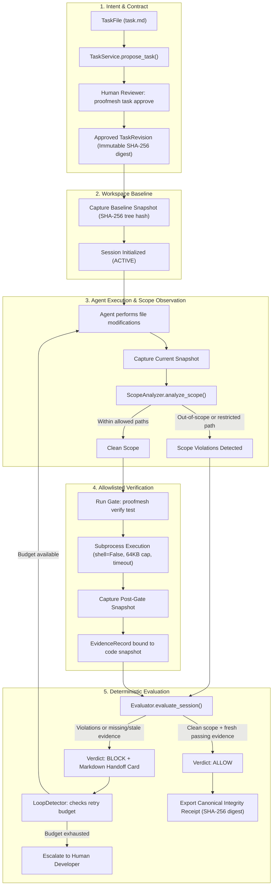
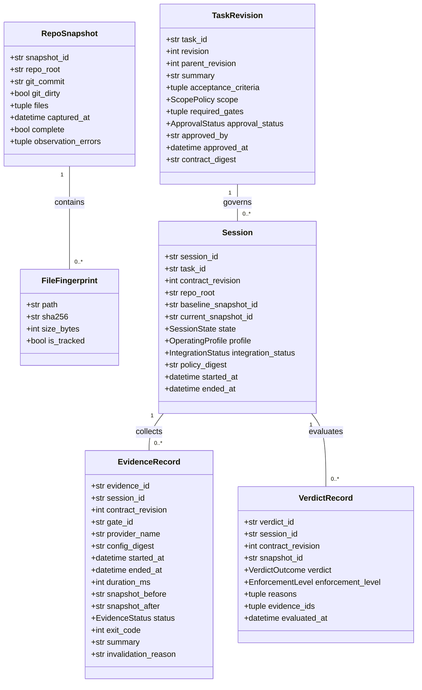
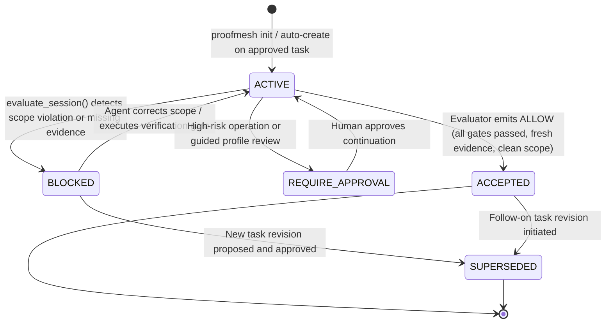
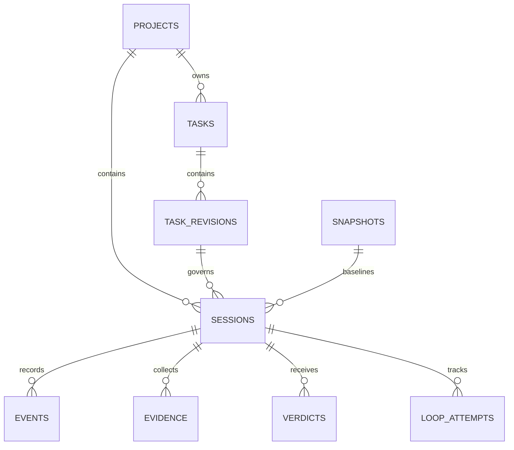

# ProofMesh Architecture & System Design

ProofMesh is an agent-neutral intent, intervention, and evidence control layer for AI-assisted software development. It operates alongside existing coding agents rather than serving as a model harness, agent orchestrator, or IDE extension.

This document describes the runtime architecture, component responsibilities, data flows, state machines, and trust boundaries implemented in the codebase.

---

## 1. Architectural Principles

1. **Agent Neutrality**: Integrates via open protocols (Model Context Protocol over stdio, host lifecycle hooks, CLI). No proprietary agent hooks or harness lock-in.
2. **Local-First & Offline Determinism**: Zero hosted model APIs, paid services, cloud databases, or network calls required for the core control loop.
3. **Decoupled Domain Models**: Domain models in `src/proofmesh/models/` are frozen, validated records with zero dependencies on SQLite, subprocess execution, or transport protocols.
4. **Isolated Persistent Storage**: State is persisted in SQLite databases outside the target project's repository tree with strict filesystem permissions (`0700` directories, `0600` files).
5. **Fail-Closed Verification**: Only allowlisted gates execute (`shell=False`, argument arrays, timeouts, bounded output buffers). Missing, failed, stale, or unknown evidence prevents task acceptance.

---

## 2. Component Organization

ProofMesh enforces a strict unidirectional dependency structure:

```
src/proofmesh/
├── models/         # Pure domain records (FrozenModel, Pydantic v2). No I/O.
├── storage/        # SQLite migrations, transactions, paths, and store queries.
├── core/           # Business logic: TaskFile, snapshot, scope, verification,
│                   # evaluator, loop detector, handoff generation.
├── providers/      # Verification providers (allowlisted pytest runner).
├── adapters/       # Official MCP server (stdio) and Antigravity hook adapter.
├── cli.py          # Unified CLI entrypoint.
├── ui.py           # Zero-dependency read-only local web status dashboard.
├── demo.py         # Deterministic 10-phase seeded recovery scenario.
├── report.py       # Human-readable Markdown and canonical JSON receipt export.
└── config.py       # Trusted policy loader and deterministic policy hashing.
```

### Module Responsibilities

| Subsystem | Modules | Core Responsibilities |
|---|---|---|
| **Domain Models** | `models/base.py`<br>`models/task.py`<br>`models/snapshot.py`<br>`models/scope.py`<br>`models/evidence.py`<br>`models/verdict.py`<br>`models/session.py`<br>`models/policy.py`<br>`models/event.py` | Immutable data structures (`FrozenModel`). Enforce UTC timestamps, bounded string fields, enum constraints, and deep immutability (`MappingProxyType`, `tuple`). |
| **Storage Engine** | `storage/store.py`<br>`storage/migrations.py`<br>`storage/paths.py` | Transactional SQLite persistence. Manages schema migrations (`001_init.sql`, `002_*.sql`), rollback on error, directory isolation (`0700`/`0600`), and parameterized queries. |
| **Task & Intent** | `core/taskfile_md.py`<br>`core/task_service.py` | Strict parsing of Markdown TaskFiles with TOML front matter. Computes canonical SHA-256 `contract_digest`. Enforces proposal and human approval lifecycles. Strips untrusted self-approval front-matter keys. |
| **Snapshot & Scope** | `core/repo_snapshot.py`<br>`core/scope_analyzer.py` | Workspace fingerprinting (SHA-256 per file, sorted tree hash). Detects Git commit and dirty status. Safely handles symlinks. Evaluates changed paths against `allow_paths`, `restricted_paths`, and file limits. |
| **Verification** | `core/verification.py`<br>`providers/pytest_runner.py` | Executes allowlisted check gates via argument arrays (`shell=False`). Captures bounded streams (max 64KB) and formats 2,000-character summaries. Binds evidence to code snapshots; invalidates evidence if workspace changes. |
| **Evaluator & Loop** | `core/evaluator.py`<br>`core/loop_detector.py`<br>`core/handoff.py` | Pure deterministic evaluation returning `ALLOW`, `BLOCK`, or `REQUIRE_APPROVAL`. Tracks repeat failure signatures with persistent retry budgets. Emits concise Markdown handoff cards. |
| **Presentation** | `report.py`<br>`ui.py` | Generates Markdown reports and canonical JSON receipts with SHA-256 integrity checksums. Runs zero-dependency read-only local dashboard on `127.0.0.1:8765`. |
| **Adapters** | `adapters/mcp_server.py`<br>`adapters/hook_protocol.py`<br>`adapters/antigravity.py` | Exposes 6 MCP tools over stdio. Handles host lifecycle hooks (`PreInvocation`, `PreToolUse`, `Stop`) with path traversal rejection. |

---

## 3. The 5-Stage Control Loop

The core workflow connects approved developer intent to fresh verification evidence before any change can be accepted:



---

## 4. Domain Data Models & Invariants

All domain models inherit from `FrozenModel` (`src/proofmesh/models/base.py`) which enforces strict immutability, extra attribute rejection (`extra="forbid"`), and recursive freezing:



### Critical Model Invariants
1. **Contract Digest**: `contract_digest` is deterministically computed as `sha256:` over canonical JSON of `(task_id, version, summary, risk_level, allow_paths, restricted_paths, required_gates, acceptance_criteria, constraints)`.
2. **Snapshot Identity**: `snapshot_id` is computed as `sha256:` over the sorted concatenation of `path:sha256\n` entries.
3. **Evidence Freshness**: Evidence is fresh if and only if `evidence.status == EvidenceStatus.PASSED`, `evidence.invalidation_reason is None`, and `evidence.snapshot_after == current_snapshot.snapshot_id`.
4. **Untrusted Front Matter Stripping**: Client-supplied self-approvals (`approval_status`, `approved_by`, `approved_at`) in front matter are stripped before parsing. Revisions can only be approved through explicit API/CLI action.

---

## 5. Session State Machine

A ProofMesh session represents an active task execution attempt bound to a project and workspace:



---

## 6. Storage & Database Schema

ProofMesh uses SQLite in WAL mode with foreign keys enabled (`PRAGMA foreign_keys = ON; PRAGMA journal_mode = WAL;`).



### Storage Location
- By default, databases are stored under `~/.local/share/proofmesh/projects/<project-id>/proofmesh.db` (overrideable via `PROOFMESH_DB`).
- All directories are created with `0700` permissions; database and companion WAL/SHM files are set to `0600`.
- Target project repositories never contain database files or internal ProofMesh logs.

---

## 7. Interface Adapters & Protocol Boundaries

### Model Context Protocol (MCP) Server (`src/proofmesh/adapters/mcp_server.py`)
- Communicates over standard input/output (`stdio`) using the official Python MCP SDK.
- **Protocol Separation**: Standard output (`sys.stdout`) is strictly reserved for official MCP JSON-RPC protocol frames. Startup messages, diagnostics, and errors are directed exclusively to standard error (`sys.stderr`).
- **Exposed Tools**:
  1. `get_task_contract`: Returns the active approved task revision, scope rules, and acceptance criteria.
  2. `inspect_changes`: Captures the current snapshot, compares it with the baseline, and returns scope findings.
  3. `run_verification`: Executes an allowlisted gate (e.g. `pytest`) and stores snapshot-bound evidence.
  4. `get_status`: Returns current session state, scope summary, gate freshness, and latest verdict.
  5. `claim_completion`: Triggers formal session evaluation. Returns `ACCEPTED` or `BLOCKED` with reasons.
  6. `get_handoff`: Emits a formatted Markdown handoff card summarizing blockers and ordered next steps.

### Host Lifecycle Hooks (`src/proofmesh/adapters/hook_protocol.py`, `antigravity.py`)
- Provides event handlers for host harnesses:
  - `PreInvocation`: Injects a concise (≤600 char) active contract reminder into agent context.
  - `PreToolUse`: Validates proposed file paths against scope rules before tool execution. Rejects directory traversals (`..`), NUL bytes, Windows drive prefixes, and symlink escapes with a `deny` decision.
  - `Stop`: Evaluates current session state before agent termination. If verification evidence is missing or stale, issues a `continue` decision with a Markdown handoff card.
